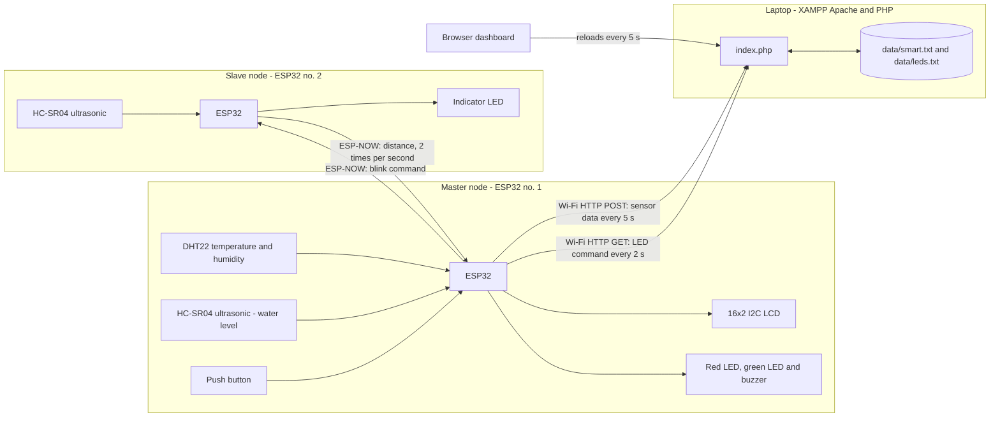
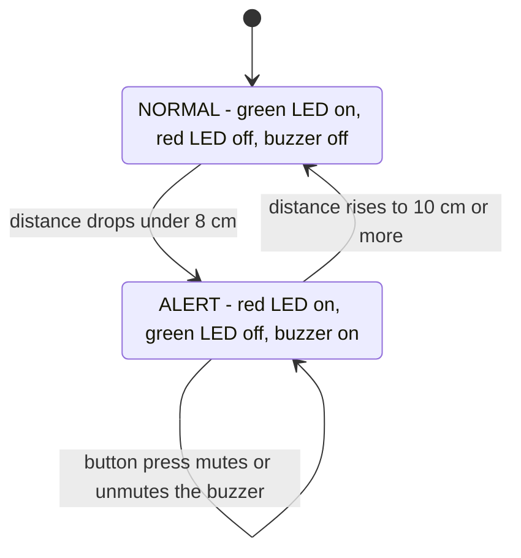
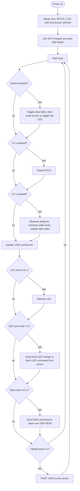
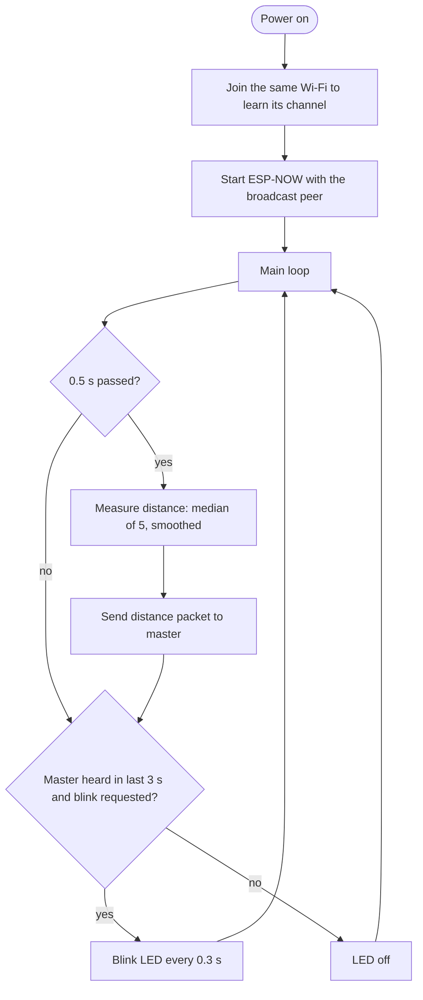
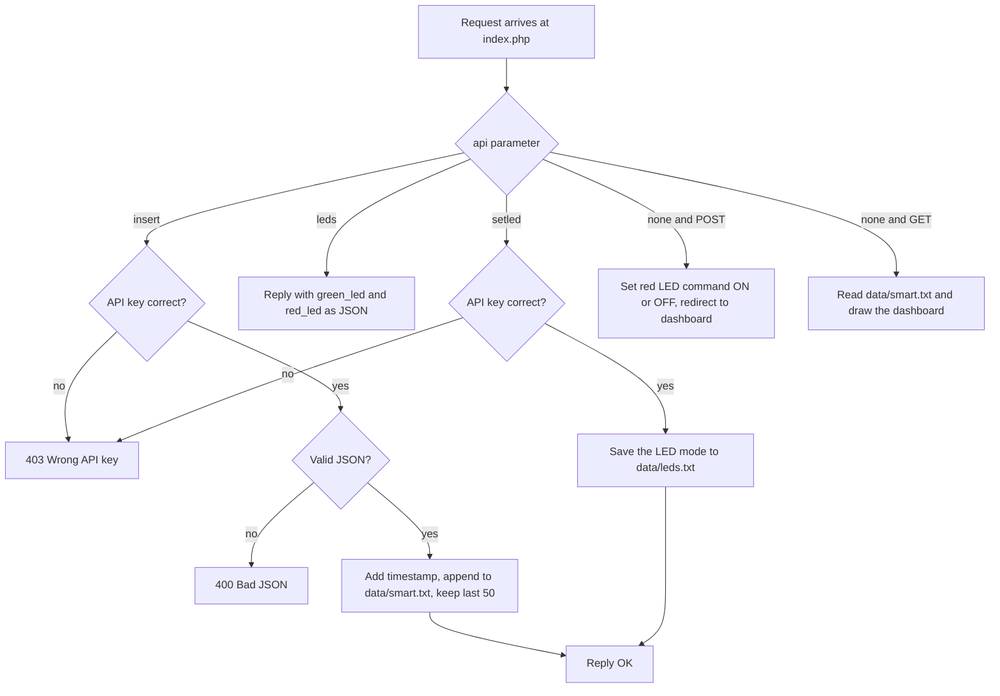
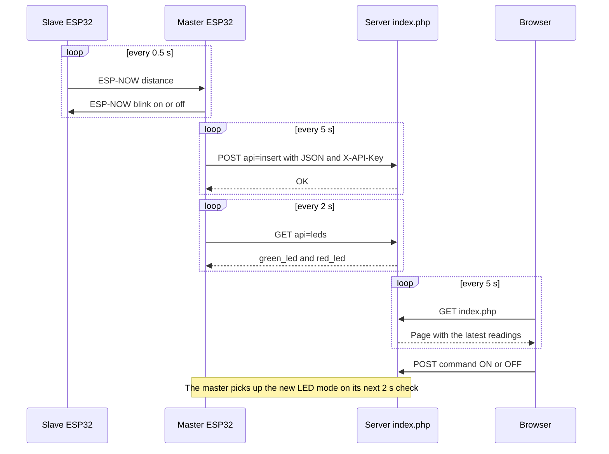

# 💧 Smart Campus Monitoring System

**Team Mavericks** 🚀 · ESP32 · ESP-NOW · Wi-Fi · XAMPP (Apache + PHP)

A two-node IoT system that watches a water tank 🪣 and the room around it. A **master ESP32** measures
temperature 🌡️, humidity 💦 and water level 📏, shows them on an LCD, raises a local alarm 🚨 and uploads
everything to a live web dashboard 🖥️. A **slave ESP32** adds a second ultrasonic distance reading and
sends it to the master wirelessly over ESP-NOW 📡. The dashboard runs on a laptop with XAMPP and needs
**no database** - readings are stored in a plain text file 📄.


---

## 📑 Table of contents
- [📖 1. Overview](#-1-overview)
- [✨ 2. Features](#-2-features)
- [🧩 3. System architecture](#-3-system-architecture)
- [🔧 4. Hardware](#-4-hardware)
- [🧠 5. How the firmware works](#-5-how-the-firmware-works)
- [🌐 6. How the server works](#-6-how-the-server-works)
- [📊 7. Results](#-7-results)
- [🚀 8. Installation and setup](#-8-installation-and-setup)
- [🧪 9. Testing without hardware](#-9-testing-without-hardware)
- [🐞 10. Troubleshooting](#-10-troubleshooting)
- [📁 11. Repository structure](#-11-repository-structure)
- [💡 12. Possible improvements](#-12-possible-improvements)
- [👥 13. Team](#-13-team)

---

## 📖 1. Overview

Water tanks on a campus are usually checked by eye, so an overflow or a dry tank is noticed late.
This project monitors a tank automatically and tells people immediately, both **on the spot**
(LCD, red LED, buzzer) and **remotely** (web dashboard).

| Part | Role |
|---|---|
| 🎛️ **Master node** | Reads the DHT22 (temperature, humidity) and an ultrasonic sensor (water level). Drives the LCD, LEDs, buzzer and push button. Receives the slave's reading and uploads all data to the server. |
| 📡 **Slave node** | Reads a second ultrasonic sensor and sends the distance to the master by ESP-NOW. Blinks an LED when the master asks. |
| 🖥️ **Server** | A single PHP file (`index.php`) on XAMPP. Receives uploads, stores the last 50 readings in `data/smart.txt`, serves the dashboard and hands LED commands back to the master. |

📏 How the level is measured: an ultrasonic sensor is mounted above the tank and measures the distance
to the water surface. **A smaller distance means more water.** The firmware treats 30 cm as an
empty tank, so `water level = 30 cm - measured distance`.

## ✨ 2. Features

- 📊 Live dashboard: temperature, humidity, water level (cm), master ultrasonic and slave ultrasonic distance
- 🕒 Table of the last 10 saved readings, refreshed automatically every 5 seconds
- 🟢 ONLINE / 🔴 OFFLINE status of the master, based on how long ago data last arrived
- 🚨 Local alarm: water closer than **8 cm** to the sensor turns the red LED and buzzer on; the push button mutes the buzzer
- 💡 LED control from the dashboard (ON / OFF) and from the push button, kept in sync with the server
- 📡 Wireless master-slave link with ESP-NOW (no router needed between the two boards)
- 🎯 Sensor filtering (median of 5 samples plus smoothing) so the readings do not jump around
- 🔁 Fault tolerant: the master keeps working and retries if Wi-Fi or the server goes down
- 🗂️ No database: data lives in text files inside `server/data/`

## 🧩 3. System architecture



**Reading the diagram**

1. The slave measures a distance and sends it to the master twice a second over **ESP-NOW**, a direct
   board-to-board protocol. The master answers with a command telling the slave LED to blink or stay off.
2. The master combines its own sensors with the slave's value, updates the LCD and local alarm, and every
   5 seconds sends one JSON message to the server over **Wi-Fi** (a Windows laptop hotspot).
3. The server stores the reading and shows it on the dashboard. Every 2 seconds the master also asks the
   server which LED mode to use, so a button on the web page can switch the LED on the hardware.

## 🔧 4. Hardware

### 🧰 Components

| Qty | Component | Used for |
|---|---|---|
| 2 | 🧠 ESP32 DevKit | Master and slave controllers |
| 1 | 🌡️ DHT22 | Temperature and humidity (master) |
| 2 | 📏 HC-SR04 ultrasonic sensor | Water level (master) and second distance (slave) |
| 1 | 🖥️ 16x2 LCD with I2C backpack (address `0x27`) | Local display (master) |
| 2 + 1 | 💡 LEDs (green and red on master, one on slave) | Status indication |
| 1 | 🔔 Buzzer | Audible alarm (master) |
| 1 | 🔘 Push button | Mute / toggle (master) |
| - | 🔌 Resistors, perfboard, breadboard, jumper wires, USB cables | Wiring and power |

### 🔌 Pin connections

**Master ESP32**

| Function | GPIO |
|---|---|
| DHT22 data | 19 |
| Ultrasonic TRIG | 5 |
| Ultrasonic ECHO | 18 |
| Green LED | 25 |
| Red LED | 26 |
| Buzzer | 27 |
| Push button (other side to GND, internal pull-up) | 4 |
| LCD I2C SDA / SCL | 21 / 22 |

**Slave ESP32**

| Function | GPIO |
|---|---|
| Ultrasonic TRIG | 5 |
| Ultrasonic ECHO | 18 |
| LED | 4 |

**⚠️ Wiring notes**
- The HC-SR04 runs on 5 V and its ECHO pin outputs 5 V, but ESP32 pins tolerate only 3.3 V. Put a
  **voltage divider** (for example 1 kOhm + 2 kOhm) on each ECHO line. The two resistors are visible next to the
  sensor connector in the photos below.
- If the LCD stays blank, change the address in `master.ino` from `0x27` to `0x3F`.
- If the buzzer or LEDs behave backwards, swap `HIGH` and `LOW` in the `BUZZER_ON`, `LED_ON` definitions.

### 📸 Photos

| Master node 🎛️ | Slave node 📡 |
|---|---|
|  |  |

The master LCD in the photo shows `T:29.5C H:32%` on the first row and `M:13.6cm S:30.0` on the second
(master distance and slave distance). The green LED is on because the water is not in the alert zone.

## 🧠 5. How the firmware works

Both sketches are written without blocking `delay()` calls in the main loop. Each task runs on its own
timer using `millis()`, so the button, sensors, display and network all stay responsive.

### 📏 5.1 Distance measurement (master and slave)

1. Take **5** ultrasonic readings, 15 ms apart. A reading with no echo counts as 30 cm.
2. Sort them and use the **median**, which removes single bad readings.
3. Smooth the result: `new = 0.6 x latest + 0.4 x previous`.
4. Limit every value to 2 - 30 cm.

The master then calculates:

```
water level (cm)   = 30 - distance
water percentage   = water level / 30 x 100
```

### 🚨 5.2 Alarm logic (master)

The alarm uses two thresholds (hysteresis) so it does not flicker when the water hovers near the limit.



The buzzer mute is cleared automatically when a new alert starts and when the alert ends.

### 🔘 5.3 Push button (master)

| Situation | What one press does |
|---|---|
| Any time | Toggles the slave LED between blinking and off |
| 🚨 Alert active | Mutes / unmutes the buzzer |
| ✅ No alert | Toggles the red LED on / off and reports the change to the server |

### 💡 5.4 LED modes

The same numbers are used by the master, the server and the dashboard.

| Mode | Meaning |
|---|---|
| 0 | Auto - follows the sensor (green on when normal, red off) |
| 1 | On |
| 2 | Blink |
| 3 | Off |

During an alert the master forces red on and green off, whatever the mode.

### 🖥️ 5.5 LCD

| Row | Content | Example |
|---|---|---|
| 1 | Temperature and humidity (`T:--  H:--` if the DHT22 is not working) | `T:29.5C H:32%` |
| 2 | Master distance, slave distance (`--` if the slave is offline), `!` at the end during an alert | `M:13.6cm S:30.0` |

### 📡 5.6 Master-slave link (ESP-NOW)

- Packets are sent to the broadcast address and carry a magic byte `0xA7`, so stray packets are ignored.
- Slave to master: `{magic, distance}` every 0.5 s. Master to slave: `{magic, blink}` every 0.5 s.
- The slave counts as **online** if the master heard it in the last 3 s, and the slave LED turns off if the
  master has been silent for 3 s.
- ESP-NOW works on one Wi-Fi channel. Both boards join the **same hotspot**, so they automatically share
  its channel. If you change the hotspot, restart both boards.

### ⏱️ 5.7 Timing

| Task | Master | Slave |
|---|---|---|
| Read DHT22 | every 2.5 s | - |
| Measure distance | every 0.5 s | every 0.5 s |
| Refresh LCD | every 0.5 s | - |
| Exchange packet over ESP-NOW | every 0.5 s | every 0.5 s |
| Sync LED command with server | every 2 s | - |
| Upload data to server | every 5 s | - |
| Retry after a failed server call | after 10 s | - |

### 🔄 5.8 Master flowchart



**Description.** After setup the master repeats one fast loop. Each decision box is a timer: when its
interval has passed, the matching task runs, otherwise the loop moves on at once. The most urgent work (button,
distance, alarm outputs) runs every pass, while slower work (DHT22, server upload) runs at its own pace.

### 🔄 5.9 Slave flowchart



## 🌐 6. How the server works

The whole server is **one file**, `server/index.php`, running on XAMPP's Apache. No MySQL is used.

### 🗄️ 6.1 Storage

The folder `data/` is created automatically next to `index.php`.

| File | Content |
|---|---|
| 📄 `data/smart.txt` | One JSON reading per line, the last **50** readings (oldest dropped automatically) |
| 💡 `data/leds.txt` | Current LED commands, for example `{"green_led":0,"red_led":3}` |

Example line in `smart.txt` (all values are examples):

```json
{"temperature":29.6,"humidity":32.6,"distance":13.7,"water_level":16.3,"water_percentage":54.3,"alert_active":0,"buzzer_muted":0,"slave_distance":30.0,"updated":1763728785}
```

`updated` is the time the server received the reading (Unix seconds). `slave_distance` is only present
while the slave is online, and `temperature` / `humidity` are only present while the DHT22 is working.
The dashboard shows `no data` for anything missing.

If `data/` cannot be created or written, the server falls back to the system temp folder and prints the
real location in the page footer.

### 📬 6.2 Requests handled by `index.php`

| Request | Sent by | Purpose | Key needed |
|---|---|---|---|
| `POST index.php?api=insert` | 🎛️ Master | Upload one reading as JSON | 🔑 yes |
| `GET index.php?api=leds` | 🎛️ Master | Ask what the LEDs should do. Reply: `{"green_led":0,"red_led":3}` | no |
| `GET index.php?api=setled&led=red&state=1` | 🎛️ Master | Report that its button changed an LED | 🔑 yes |
| `POST index.php` with `command=ON` or `OFF` | 🖥️ Dashboard buttons | Set the red LED command | no |
| `GET index.php` | 🌍 Browser | Show the dashboard | no |

🔑 The API key is the text `Campus123`, sent in the `X-API-Key` header (or as `?key=`). It must be the same
in `master.ino` and `index.php`. A wrong key returns **403**, invalid JSON returns **400**.

### 🧭 6.3 Request routing



### 🔁 6.4 Data flow over time



### 🖥️ 6.5 Dashboard behaviour

- 🔄 The page reloads itself every **5 seconds** (`<meta http-equiv="refresh" content="5">`).
- 📊 The five main boxes show the **newest** reading: temperature, humidity, water level, master ultrasonic, slave ultrasonic.
- 🕒 The table lists the **last 10** readings, newest first, with times shown in IST.
- 🟢 **Master: ONLINE** appears when the newest reading is 15 seconds old or less, otherwise 🔴 **OFFLINE**.
- 📡 The slave box says `slave offline` when no slave distance was included.

### 🔒 6.6 Security notes

- 🔑 Only devices that know the API key can upload data or change LED state from the master.
- 🛡️ `.htaccess` blocks direct browser access to the `.txt` data files and turns off folder listing.
- ⚠️ The Wi-Fi password and API key are written in the code. Change them to your own values before making the
  repository public, or keep the repository private.
- 🚧 The dashboard LED buttons have no login. This is fine inside a private hotspot for a demo; before any
  wider use, add authentication and HTTPS.

## 📊 7. Results


✅ The photo shows the system running end to end: the master is **ONLINE** (last data 4 seconds ago), and
the five boxes show 29.6 C, 32.6 %, a water level of 16.3 cm, a master distance of 13.7 cm and a slave
distance of 30 cm.

The saved-entries table also shows the water level logic working. As an object is brought towards the
master sensor, the master distance falls (10.3, 9.7, 6.7, 5.6, 3.5 cm), so the water level rises
(19.7, 20.3, 23.3, 24.4, 26.5 cm) and the distance goes below the 8 cm alert threshold. When the object is
removed the distance returns to about 30 cm and the water level to about 0 cm. Every row obeys
`water level = 30 - distance`. Entries arrive 5 seconds apart, matching the upload interval.

## 🚀 8. Installation and setup

### 💻 8.1 Server (laptop)

1. Install **XAMPP** and start **Apache** (MySQL is not needed).
2. Copy `server/index.php` and `server/.htaccess` to
   `C:\xampp\htdocs\student-sites\team13\`
3. Turn on the Windows **Mobile Hotspot** and use the same network name and password as `WIFI_NAME` and
   `WIFI_PASS` in both sketches. The laptop address on the hotspot is `192.168.137.1`.
4. Allow Apache (port 80) through Windows Firewall for private networks.
5. Open `http://192.168.137.1/student-sites/team13/` - you should see the dashboard with `Master: OFFLINE`.

### 🔌 8.2 Master and slave (Arduino IDE)

1. Install the **ESP32** board package.
2. Install libraries from the Library Manager: *DHT sensor library* (Adafruit), *Adafruit Unified Sensor*,
   *LiquidCrystal I2C*.
3. Open `firmware/master/master.ino` and check these settings:

   | Setting | Value |
   |---|---|
   | `WIFI_NAME` / `WIFI_PASS` | Hotspot name and password |
   | `SERVER_IP` | `192.168.137.1` |
   | `TEAM` | `team13` (must equal the folder name in `student-sites`) |
   | `API_KEY` | `Campus123` (must equal `$API_KEY` in `index.php`) |

4. Select your ESP32 board and port, then upload.
5. Open `firmware/slave/slave.ino`, set the same `WIFI_NAME` and `WIFI_PASS`, then upload.
6. Open the Serial Monitor at **115200** baud on the master. You should see
   `Sent to dashboard, response: 200` every 5 seconds. ✅

### 🎚️ 8.3 Tuning

| Constant (in `master.ino`) | Default | Meaning |
|---|---|---|
| `MAX_DISTANCE_CM` | 30 | Distance that counts as an empty tank (set to your tank depth) |
| `ALERT_ON_CM` | 8 | Alert starts when the distance is below this |
| `ALERT_OFF_CM` | 10 | Alert ends when the distance is back to this or more |
| `UPLOAD_EVERY` | 5000 ms | Upload interval |

## 🧪 9. Testing without hardware

You can check the server alone. In Windows PowerShell use `curl.exe` (plain `curl` is a different command there).

```bash
# Send a fake reading
curl.exe -X POST -H "X-API-Key: Campus123" -H "Content-Type: application/json" -d "{\"temperature\":27.5,\"humidity\":55,\"distance\":12.3,\"water_level\":17.7,\"water_percentage\":59,\"alert_active\":0,\"buzzer_muted\":0,\"slave_distance\":9.8}" "http://192.168.137.1/student-sites/team13/index.php?api=insert"

# Read the LED command (what the master receives)
curl.exe "http://192.168.137.1/student-sites/team13/index.php?api=leds"
```

The first command should print `OK` and the dashboard should show the values within 5 seconds.
Sending the same request with a wrong key should return `Wrong API key`.

## 🐞 10. Troubleshooting

| Symptom | Likely cause and fix |
|---|---|
| ❌ Serial Monitor shows `response: 404` | `TEAM` in `master.ino` does not match the folder name in `student-sites` |
| 🔑 Serial Monitor shows `response: 403` | `API_KEY` differs between `master.ino` and `index.php` |
| ↪️ `response: 302` | Likely an older dashboard without `api=insert` support is still on the server. Use this repo's `index.php` |
| 📶 `response: -1` or "Server not reachable" | Wrong Wi-Fi details or `SERVER_IP`, Apache not running, or Windows Firewall blocking port 80 |
| 🌡️ Dashboard says `no data` for temperature and humidity | DHT22 wiring or pin. The LCD will show `T:--  H:--` |
| 📡 Slave box says `slave offline` | Slave not powered, or it joined a different Wi-Fi. Restart both boards after any hotspot change |
| 📏 Slave or master always reads 30 cm | Nothing within range of the sensor, or the ECHO wire is loose |
| 📂 Footer says "server temp folder" | The `data` folder could not be created. Create an empty `data` folder next to `index.php` |
| 🖥️ LCD is blank | Try address `0x3F`, adjust the contrast screw on the I2C backpack |
| 🔔 Buzzer or LEDs behave backwards | Swap `HIGH` and `LOW` in the `*_ON` / `*_OFF` definitions |

## 📁 11. Repository structure

```
smart-campus-monitoring/
├── README.md
├── .gitignore
├── docs/
│   └── images/               Photos used in this README
├── firmware/
│   ├── master/master.ino     Master ESP32: sensors, LCD, alarm, button, Wi-Fi upload
│   └── slave/slave.ino       Slave ESP32: ultrasonic, LED, ESP-NOW
└── server/
    ├── index.php             Dashboard and API in one file
    └── .htaccess             Blocks direct access to the data files
```

`server/data/` is created at run time and is ignored by Git.

## 💡 12. Possible improvements

- 📈 Live charts of water level and temperature over time
- 🚰 Automatic pump control to refill the tank when the level is low
- 📱 SMS, WhatsApp or e-mail alerts when an alert starts
- 🏫 More slave nodes (several tanks or rooms)
- 🔐 Login for the dashboard and HTTPS
- ☀️ Battery or solar power for the nodes

## 👥 13. Team

**Team Mavericks** 🚀 (project folder `team13`)

| | Name | Role | Responsibilities |
|---|---|---|---|
| 👑 | **Rishi Rena** | Team Leader and Embedded Hardware Designer | Led the team and planned the project. Designed the embedded hardware: circuit design and wiring of the master and slave nodes. |
| 🔌 | **Aastha Pandya** | Hardware and Firmware (Arduino IDE) Developer | Built and tested the hardware. Wrote and uploaded the ESP32 firmware for the master and slave in the Arduino IDE. |
| 🖥️ | **Revansh Jain** | Server and Dashboard Developer | Built the XAMPP / PHP server: the API, data storage and the live dashboard. |

---

Made with ❤️ by Team Mavericks
